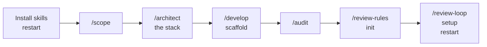
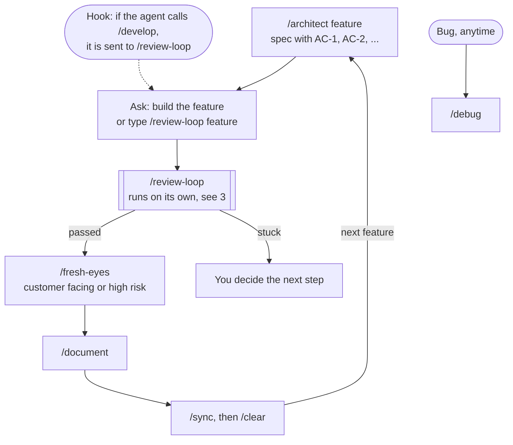
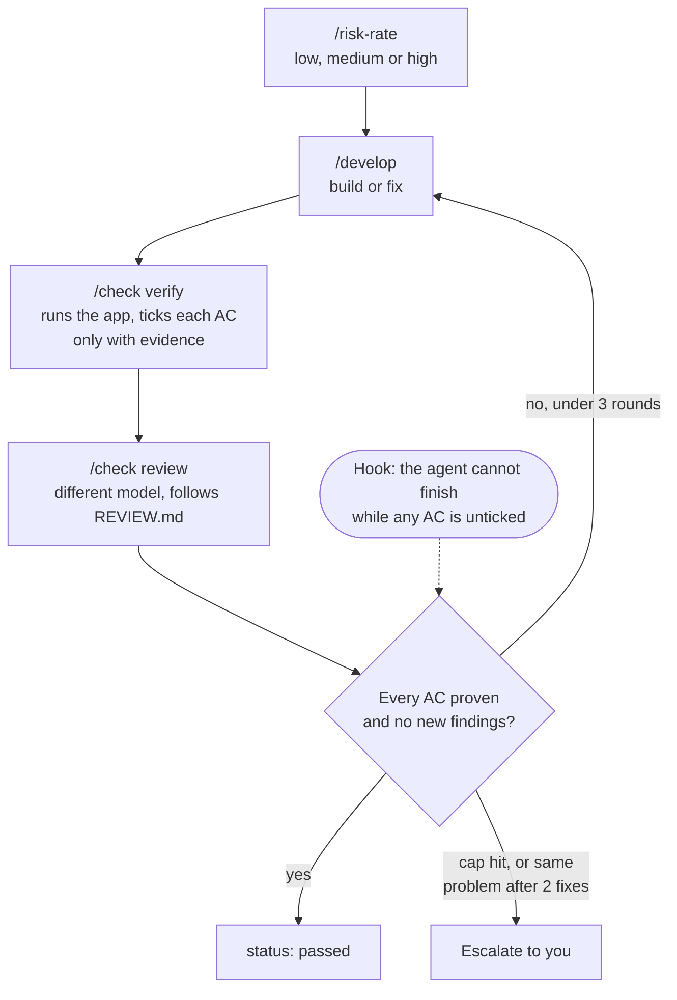

# Starting a fresh project

How a new project goes from an empty folder to features that build, verify and review themselves. Set up once, then repeat the feature loop.

## 1. Once per project

1. `npx skills@latest add toyinogun/skills -a claude-code`, then restart Claude Code.
2. `/scope` the idea and pick `Beta` or `GA` depth.
3. `/architect` the stack, then `/develop scaffold` to create the empty project.
4. `/audit` writes `AGENTS.md`; `/review-rules init` writes `REVIEW.md`.
5. `/review-loop setup`: approve the settings write, say yes to the `AGENTS.md` snippet, restart.

## 2. Each feature

## 3. Inside `/review-loop`

## What you type and what happens on its own

| You type | Happens on its own |
|---|---|
| The setup steps, once | `/develop` from the agent is routed into `/review-loop` |
| `/architect <feature>` for each feature | Risk rating, rounds, verify, review, round caps |
| "build X" or `/review-loop X` | "Done" is blocked until every criterion is ticked |
| `/fresh-eyes`, `/document`, `/sync` | Reviews apply `REVIEW.md` through the `AGENTS.md` snippet |

Shortcuts: a bug goes straight to `/debug`. A tiny throwaway change can be `/develop` typed by you, since typed commands are never redirected. To switch routing off on one machine, create `.review-loop/off`.

More on the loop itself: [review-loop.md](review-loop.md).
